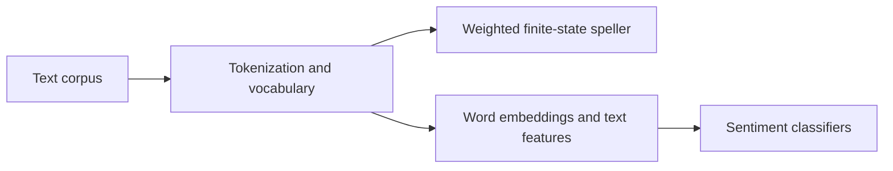

# NLP experiments — finite-state spelling correction and sentiment analysis

A notebook-based exploration of weighted finite-state spelling correction, word representations and text classification, developed for an NTUA speech and natural-language processing laboratory.

## Start here

Open the [experiment notebook](fwnhkaiglwssa-VlachosI-lab1-speller%26embeddings.ipynb). It contains code, intermediate outputs and analysis primarily in Greek.

## Methods

- Corpus construction, tokenization, dictionaries and symbol tables.
- OpenFST transducers and acceptors for edit-based spelling correction.
- Weighted alternatives based on character and word statistics.
- Word2Vec experiments and comparison of semantic neighbors.
- Text representations and scikit-learn classifiers for sentiment analysis.



## Local inspection

Use a Python environment with Jupyter:

```bash
python -m pip install jupyterlab
python -m jupyter lab
```

For execution, inspect the notebook's setup and imports. It uses NumPy, pandas, NLTK, Gensim and scikit-learn, plus external OpenFST command-line tools and Graphviz for automata diagrams. Install those tools separately; installing Python packages alone does not provide them.

## Reproducibility notes

Only the notebook is committed. Source corpora, generated FST files, local images and other referenced resources are not packaged here. Some cells use shell commands and older library APIs. Reconstruct the inputs and adjust paths before running the full workflow.

The saved outputs are historical coursework results, not a newly reproduced evaluation. The original notebook preserves assignment context and attribution.
